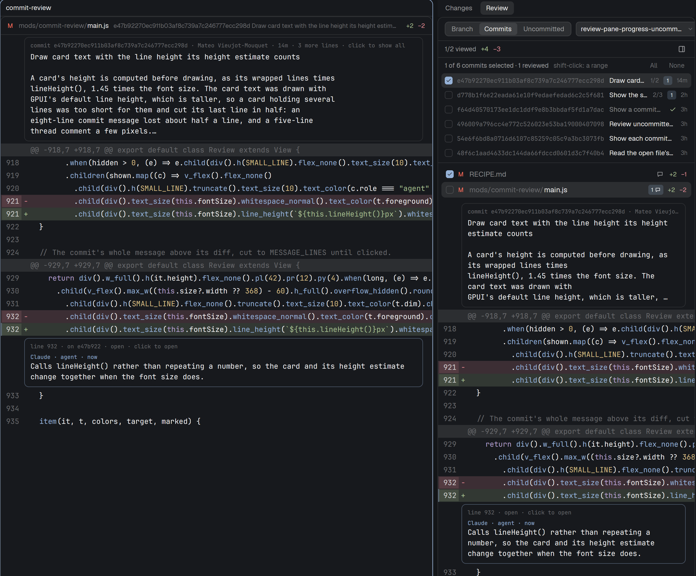

# Commit review for Herdr

A [Herdr](https://herdr.dev) app mod that reviews work the way a pull request
is reviewed, together with your coding agents. Pick a whole branch, single
commits or the uncommitted changes, tick off each file as you read it, and
leave comments on lines.
Agents read your comments, answer them, mark them resolved, and can leave
review comments of their own, all with one small command.



- **Branch, commits or uncommitted.** Branch mode shows everything a branch
  adds since it left its base branch (from the merge base to the tip). Commits
  mode lists the branch's commits; tick one or several (shift-click for a range)
  and each is shown as its own diff, under the commit's full message. A branch
  filter picks which branch.
  Uncommitted mode shows the working tree against HEAD, new files included. Its
  threads belong to that worktree, and still show in Branch mode once the work
  is committed.
- **Viewed ticks.** Every file has a Viewed box. A file you ticked shows
  "changed" again when a later commit changes it, as on GitHub, or in
  Uncommitted mode when it is edited again.
- **Commit progress.** Each commit in the list shows how far its review got,
  from its files' ticks: `2/5` while it is in review, a green check once every
  file is viewed. An amended or rebased commit keeps its ticks and threads (it
  is recognised by its author, author date and subject); a file that differs
  afterwards shows "changed", and so does the commit.
- **Reader pane.** The pane button at the right of the status row opens the
  open file's diff in a pane beside the terminal, with more room to read. It
  has the same threads and comment card, and follows the file you pick in the
  panel.
- **Threads.** Click a line (click another to widen the range, or click a hunk
  header for the whole hunk) to comment; the speech bubble on a file row
  comments on the whole file. Your comments stay pending until **Submit
  review**, which pastes them, with their lines, into an agent of the space.
- **Agents answer in the panel.** Agents reply, resolve and open threads with
  `herdr-review`; the panel shows their comments within seconds, with a
  notification.
- **Ask agent.** Starts an agent you pick in a new tab, asked to review what
  the panel shows and to record each finding as a thread, without changing code.

## Requirements

- The Herdr app (tested with 0.1.11) and herdr-core (tested with 0.1.16).
- git 2.31 or newer, and Python 3.9 or newer for `herdr-review`.

## Install

1. Install `herdr-review` on every machine whose repositories you review: this
   one, and each machine of a remote space, because the panel runs it there.

   ```sh
   install -D -m 755 herdr-review/herdr-review.py ~/.local/bin/herdr-review
   herdr-review --help
   ```

   Agents that run in a sandbox need it on the sandbox's `PATH`, and need write
   access to the repository's git directory (see [Storage](#storage)).
   Reinstall it whenever you update the mod: the panel checks that both use the
   same format, and says so when they do not.

2. Copy the mod into the Herdr app's folder and check it:

   ```sh
   cp -r mods/commit-review ~/.config/herdr-app/mods/
   herdr-app check ~/.config/herdr-app/mods/commit-review
   ```

3. Show it. Its `mod.json` places it nowhere, so choose one:

   - **As a pane**, beside the terminal of a repository:

     ```sh
     herdr-app do pane.split '{"direction":"right","mod":"commit-review"}'
     ```

   - **As the Review half of the Changes panel.** Clone Herdr's layout
     (`herdr-app do layout.clone '{"name":"main","as":"my-layout"}'`), then in
     `~/.config/herdr-app/layouts/my-layout.json` replace the `changes` block
     with this column. Its top strip switches between Herdr's own Changes panel
     (Changes, with its Commit box) and this panel (Review). The ids must stay
     as they are: the strip selects `changes-work` and `changes-commits` in
     `changes-views`.

     ```json
     { "id": "changes", "type": "column", "resizable": false, "children": [
       { "id": "changes-switch", "type": "block", "size": { "px": 32 },
         "content": { "mod": "commit-review", "props": { "switch": true } } },
       { "id": "changes-views", "type": "stack", "active": "changes-work", "children": [
         { "id": "changes-work", "type": "block", "content": { "mod": "changes" } },
         { "id": "changes-commits", "type": "block", "content": { "mod": "commit-review" } } ] } ] }
     ```

## Agents and `herdr-review`

The panel tells an agent everything it needs when it sends a review or starts
a reviewer, so an agent does not have to know the command beforehand. These
are the commands an agent uses, run inside the repository:

```sh
herdr-review list                                   # open threads
herdr-review show k3x9a2                            # one thread, with its lines
herdr-review reply k3x9a2 --author Codex -- "Fixed in 3f2a1c9."
herdr-review resolve k3x9a2
herdr-review comment --commit 3f2a1c9 --path src/app.rs --line 42 --author Codex -- "This clone is not needed."
herdr-review comment --branch my-feature --path src/app.rs --line 42 -- "..."
herdr-review comment --uncommitted --path src/app.rs --line 42 -- "..."
```

Line numbers are the file's lines in that commit (at the branch's tip, or in
the working tree for `--uncommitted`); `--side old` comments on a removed line,
numbered as before the change. `--uncommitted` threads belong to the worktree
they were written in: `herdr-review list --uncommitted` lists that worktree's.
`--author` is the name the panel shows; without it a comment is signed
"agent". A thread on a commit follows it through amend and rebase:
`herdr-review list --commit` also finds threads written on an earlier version
of it. `herdr-review --help` explains the rest.

## Storage

Threads live under the repository's git directory, in
`$(git rev-parse --git-common-dir)/herdr-review/` (`herdr-review path` prints
it): one JSON file per thread in `threads/`, and the Viewed ticks in
`viewed.json`. Every worktree of the repository shares them, and they are never
committed. Every write takes a lock on that folder, so the panel and any number
of agents can write at the same time.

## What it runs and reads

The mod runs `git` (reads only, with the flags that keep it from taking the
index lock) and `herdr-review` on the machine of the space it shows. Submit
review types the review into the chosen agent's terminal with `hc send`, and
Ask agent starts the chosen agent in a new tab with `tab.new`. It reads no file
outside the repository and makes no network request.

## For other mods

- `setShared("commit-review.request", { root, on, commits: [sha], at: Date.now() })`
  shows those commits in Commits mode, when `root` (the repository's top folder)
  and `on` (the machine, `null` for this one) match what the panel shows. A
  commit menu can offer "Review commit" this way; to bring the Changes switch to
  this panel as well, run `layout.select {stack: "changes-views", child: "changes-commits"}`.
- Mod commands for `keys.json`: `commit-review.submit`, `commit-review.next`
  (the next file not viewed yet) and `commit-review.mode` (the next of Branch,
  Commits and Uncommitted).
- Props: `font_size` (px; default: the terminal's font size minus one),
  `base` (the branch reviews compare against; default: origin's HEAD branch,
  else `main`, else `master`) and `reader` (`true`: the reader pane, which
  shows the file the panel has open).

## Development

```sh
bash herdr-review/test.sh "$(command -v herdr-review)"   # needs git and jq
herdr-app check mods/commit-review
```

## Licence

Apache-2.0, see [LICENSE](LICENSE) and [NOTICE](NOTICE). The check, chevron
and panel icons are Lucide icons under the ISC licence
([mods/commit-review/LICENSE-lucide.txt](mods/commit-review/LICENSE-lucide.txt)).
