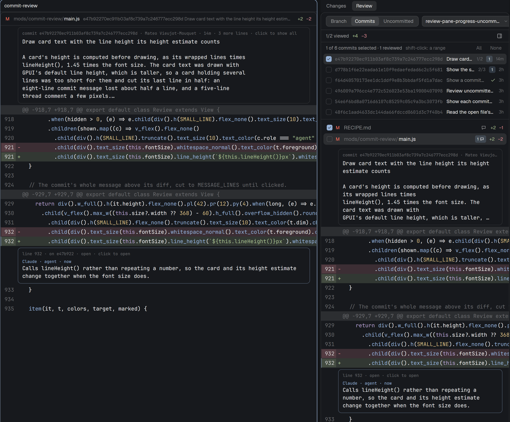

# Commit review

A panel that reviews committed work like a pull request: a whole branch, or
commits picked from it, with a Viewed tick per file and comment threads on
lines. The person's comments go to a coding agent as one message; agents
answer, resolve and open threads with a small command, `herdr-review`, and the
panel shows their comments within seconds.

## What you see

Top to bottom, in one rounded card on the theme's `background`:

1. **Header**, 42px: a two-pill switch **Branch | Commits** (24px pills in a
   bordered `raised` box), a branch picker (a select-looking box with the branch
   name and a chevron; its popover lists local branches, marking "checked out"
   and "base"), then on the right **Ask agent** (a box with a chevron; its
   popover lists the installed agents).
2. **Status row**, 30px, 11.5px text: "3/12 viewed" (green when all are
   viewed), `+added` in green and `−removed` in red, and on the right a 22px
   pane button (Lucide's panel-right) while a file is open, then a solid
   **Submit review · N** button while the person has pending comments.
3. **Commit strip.** In Branch mode one line, "N commits on <branch> since
   <base> · merge base <short sha>", which unfolds a read-only list. In
   Commits mode "K of N commits selected · shift-click: a range · All · None",
   then a list of 26px rows: a tick box, the short hash in the code font, the
   subject, an open-thread count badge, and the age ("3h", "2d"). Commits not on
   the branch (from a request) carry a "not on <branch>" tag.
4. **File list**, up to 220px, 28px rows: a Viewed tick box (accent when ticked,
   `blocked` border when the file changed since), the status letter (A green,
   D red, others `blocked`), the folder dimmed and the file name, "changed" in
   `blocked` when it changed since it was viewed, a speech bubble with the open
   thread count, and the line counts. Viewed rows are dimmed to 50%. With
   several commits, each commit's files sit under a header row (hash, subject).
5. **Diff**, the rest: a virtual list in the terminal's font, one size smaller.
   Hunk headers on `raised`; added and removed rows tinted with the theme's
   green and red, a tinted gutter with the line number, and a colored sign
   column; syntax colors from the theme's ANSI colors. Thread cards sit under
   the last line they are about, indented 42px, with a header ("lines 40–44 ·
   open · click to open"), up to three comments (author, "agent" for agents,
   age, "pending"), each cut to five lines. Rows under a thread keep a faint
   accent mark in their left border.
6. **Comment card**, 340px, floating over the top right of the diff (a strip
   under it when the panel is narrower than 600px): a new comment's box, or a
   whole thread with its lines, every comment, a reply box and Resolve / Reopen
   and Send to agent.

With `props.switch` the mod draws only a 32px strip with two pills,
**Uncommitted | Committed**, which switch the layout stack `changes-views`
between `changes-work` and `changes-commits`. With `props.dialog` it draws only
the send dialog. With `props.reader` it is the reader pane: a 32px header (the
status letter, the folder dimmed and the file name, what it is a diff of, and
the line counts), then the diff, thread cards and comment card as in the panel,
for the file the panel has open; "Pick a file in the review panel to read it
here" while there is none.

## How it behaves

- It follows the focused terminal's folder (a focused mod pane uses its tab's
  first terminal) and that space's machine.
- A click on a diff row opens the comment card on that line; another click
  widens the range, a click inside the range clears it, a click on a hunk header
  takes the whole hunk. Enter adds, shift-enter starts a new line, Esc closes.
- A new comment is saved at once as pending. Pending comments are hidden from
  agents. Submit review opens the send dialog with every pending comment and
  its lines; once the text is sent, the comments are submitted.
- A click on a thread card opens the thread in the card. The person's pending
  comments can be edited or deleted; submitted ones cannot.
- Ticking Viewed on the open file opens the next file not viewed yet.
- The pane button splits the followed terminal's pane to the right with the
  reader. The panel shares its open file (`commit-review.follow`: the
  repository, the unit with what its threads match, and the file) whenever that
  changes; the reader loads that file's diff and threads itself and follows
  each change. Another file closes a new comment there; an open thread stays.
  Key commands and notifications stay with the panel, so each happens once.
- Agent status colors the dots in the send dialog: working, blocked, done and
  idle use the theme's colors of those names. Sending to a blocked agent takes
  a second press, "Send anyway".
- A comment an agent submits raises a notification "<author> commented on
  <file>:<line>".
- The panel reloads git state every 10 seconds, and the threads whenever their
  folder changes (on this machine; a remote space waits for the timer).

## Built from

- `mods/commit-review/main.js`: the panel, the switch strip and the entry of
  the dialog. `git.js`: git reads (`rev-parse`, `for-each-ref`, `merge-base`,
  `log -z`, `diff --raw --numstat -z --no-abbrev`, `diff` of one file), each
  with `--no-optional-locks -c core.fsmonitor=false -c diff.autoRefreshIndex=false`.
  `store.js`: every thread read and write goes through `exec("herdr-review", …,
  { cwd, on })`. `diff.js`: diff rows and thread placement. `highlight.js` and
  `palette.js`: the tokenizer and its colors. `agent.js`: the review message and
  the reviewer's task. `dialog.js`: the send dialog.
- `herdr` functions: `spaces`, `panes`, `focused`, `layout`, `theme`,
  `settings`, `props`, `shared`/`setShared`, `nextCommand`, `exec`, `hc`,
  `agents`, `knownAgents`, `watchFolder`, `openOverlay`/`closeOverlay`,
  `notify`, `run` (`tab.new`, `pane.split`, `layout.select`, `agent.focus`).
- `herdr-review/herdr-review.py`: Python standard library only; threads in
  `<git common dir>/herdr-review/threads/<id>.json`, ticks in `viewed.json`,
  an `fcntl` lock around every write, atomic renames.
- Icons: Lucide's check, chevron-down and panel-right, and a speech bubble.

## Watch out

- A virtual list row can hold no handler and no input, so thread cards open
  through the list's `on_item_click`, and the comment card floats outside it.
- Card heights are computed before drawing (comments cut to five wrapped lines,
  the last three comments): keep that estimate and the drawing in step.
- A thread is placed where its first quoted line still is, nearest its line
  number; when that text is gone it is listed at the top as "not in this diff"
  instead of being guessed onto other code.
- A root commit is compared to the empty tree, asked of git
  (`git hash-object -t tree /dev/null`) so SHA-256 repositories work.
- `herdr-review` takes option values as `--name=value`, because a quoted line
  can start with "-".
- The send dialog types the text into a terminal: more than about 8 KB is slow
  or cut short in some agents, and the dialog says so.

## Done when

- `herdr-app check mods/commit-review` passes.
- `bash herdr-review/test.sh "$(command -v herdr-review)"` passes, and fails
  when the lock in `herdr-review.py` is removed.
- In a repository on a branch with commits, Branch mode lists them and the
  files; ticking a file dims it, and after a new commit to that file the row
  reads "changed".
- A comment on a line stays pending, `herdr-review list` does not show it,
  Submit review sends it, and then `herdr-review list` does.
- `herdr-review comment --commit HEAD --path <a changed file> --line <a changed line> -- "x"`
  makes a card appear under that line, with a notification.
- The pane button opens a reader beside the terminal that shows the open file;
  picking another file in the panel changes it, and a comment added in the
  reader appears in the panel.
